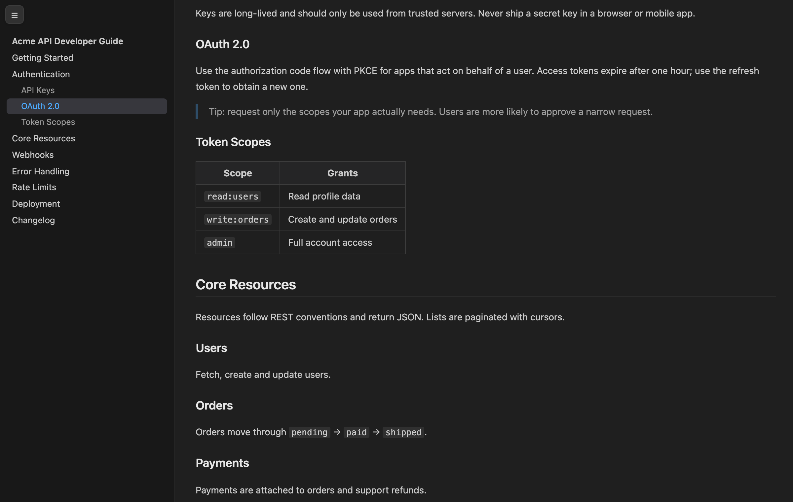
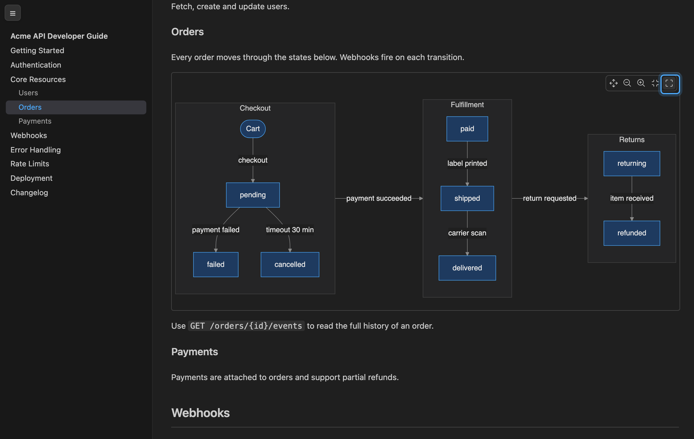
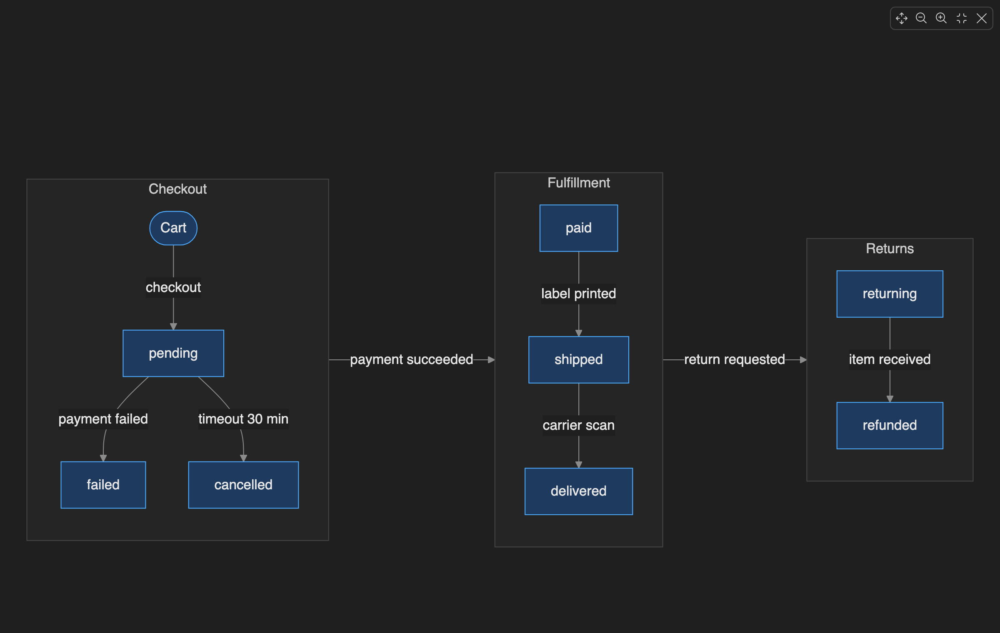

# Markdown Preview TOC

Adds a **table of contents sidebar** and a **fullscreen button for Mermaid diagrams** to VS Code's built-in Markdown preview. Everything else, including Mermaid diagrams, math, syntax highlighting and other preview extensions, keeps working as before, because this extension doesn't replace the preview. It only adds to it.

## Features

- **Sidebar outline**: lists `h1`, `h2` and `h3` headings on the left side of the preview.
- **Click to jump**: click any entry to scroll to that heading.
- **Scroll tracking**: the current section is highlighted as you scroll, and the sidebar scrolls itself to keep the active entry visible.
- **Focused outline**: `h3` entries are shown only under the section you're currently reading, so long documents stay easy to scan.
- **Collapsible**: click the **☰** button in the top-left corner to hide or show the sidebar. Your choice is remembered.
- **Responsive**: in a narrow preview (≤ 520px) the sidebar becomes an overlay that doesn't squeeze the content, and it closes after you pick a heading.
- **Theme-aware**: all colors come from your VS Code theme, so it looks right in light, dark and high-contrast themes.
- **Easier reading**: when the TOC is shown, line length is capped and line height is increased.
- **Print-friendly**: the sidebar and button are hidden when printing or exporting.
- **Live updates**: the outline rebuilds as you edit the document and when you switch between files.
- **Zero config**: no settings and no commands. Install it and open a preview.

### Mermaid fullscreen

Wide diagrams get shrunk to fit the text column. A **fullscreen** button in the diagram toolbar opens the diagram across the whole preview, scaled up to fit.

- **One click**: hover a diagram and click the fullscreen button at the end of the toolbar, next to pan, zoom out, zoom in and reset.
- **Built-in zoom still works**: pan, zoom and reset behave as usual while in fullscreen.
- **Easy exit**: press `Esc` or click **×**. The diagram returns to its original size, and the preview stays where you were.
- **Works without the toolbar**: if you hide the built-in toolbar (`markdown-mermaid.controls.show: never`), the fullscreen button is still shown in the diagram's corner.

## Usage

1. Open any Markdown file.
2. Open the preview as you normally would:
   - **Open Preview**: `Ctrl+Shift+V` (`Cmd+Shift+V` on macOS)
   - **Open Preview to the Side**: `Ctrl+K V` (`Cmd+K V` on macOS)
3. The table of contents appears on the left. Use **☰** to collapse or expand it.
4. To view a Mermaid diagram fullscreen, hover it and click the fullscreen button at the end of its toolbar. Press `Esc` to exit.

If the document has no `h1`–`h3` headings, the sidebar and button stay hidden.

## How it works

The extension uses VS Code's official Markdown preview extension points:

- `markdown.previewScripts` injects two small scripts. One reads the headings in the rendered preview and builds the outline. The other adds the fullscreen button to each Mermaid diagram rendered by VS Code's built-in Mermaid support.
- `markdown.previewStyles` injects the sidebar and fullscreen styles.

It doesn't register a custom editor or webview, and it doesn't change your files. Headings without an `id` get a generated one (`mdtoc-N`) inside the preview only.

## Requirements

- VS Code **1.80.0** or later.
- The built-in **Markdown Language Features** extension must be enabled (it is by default).
- Mermaid fullscreen needs a VS Code version that renders Mermaid in the built-in preview (the built-in **Mermaid Markdown Features** extension). With older versions, the TOC still works and the fullscreen button doesn't appear.

## Compatibility

- Works alongside other preview extensions such as Mermaid, KaTeX/Markdown+Math and Markdown Preview Enhanced styles, because it adds to the built-in preview instead of replacing it.
- Doesn't affect the **Markdown Preview Enhanced** extension's own preview, which is a separate webview.

## Known limitations

- Only `h1`–`h3` are listed. Deeper headings (`h4`–`h6`) aren't included.
- The collapsed/expanded state is saved in the preview's local storage. If the webview blocks storage, the sidebar falls back to expanded on each open.
- Mermaid fullscreen fills the preview pane, not your whole screen, because the preview runs inside an editor tab. For more room, maximize the editor group first (double-click the tab, or `Ctrl+K Ctrl+M` / `Cmd+K Cmd+M`).
- The fullscreen button attaches to the diagram markup produced by VS Code's built-in Mermaid support. Diagrams rendered by other Mermaid extensions don't get the button.

## Privacy

This extension collects no data and makes no network requests.

## Release Notes

### 0.2.1

- Mermaid fullscreen: exiting no longer moves the preview's scroll position.
- The exit button now shows **×**, so it isn't confused with the built-in reset-zoom button.
- Adds side margins around diagrams in fullscreen.

### 0.2.0

- New: fullscreen button for Mermaid diagrams.

### 0.1.2

- Rebuilds the outline more reliably when switching between preview and source, or when the preview content is replaced.

### 0.1.0

- Initial release: sidebar TOC (h1–h3), click to jump, scroll tracking, collapse toggle, responsive overlay, theme colors.

## License

[MIT](LICENSE)
